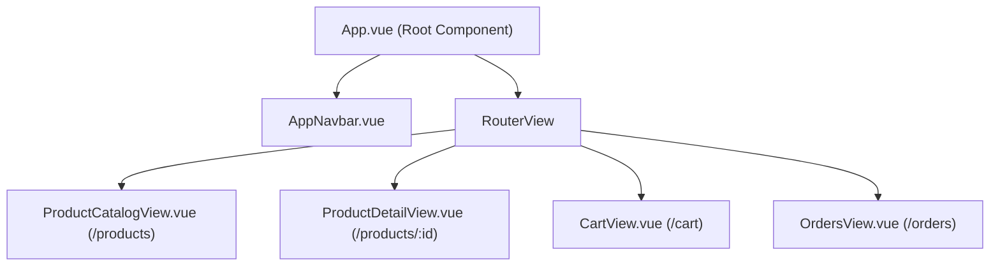
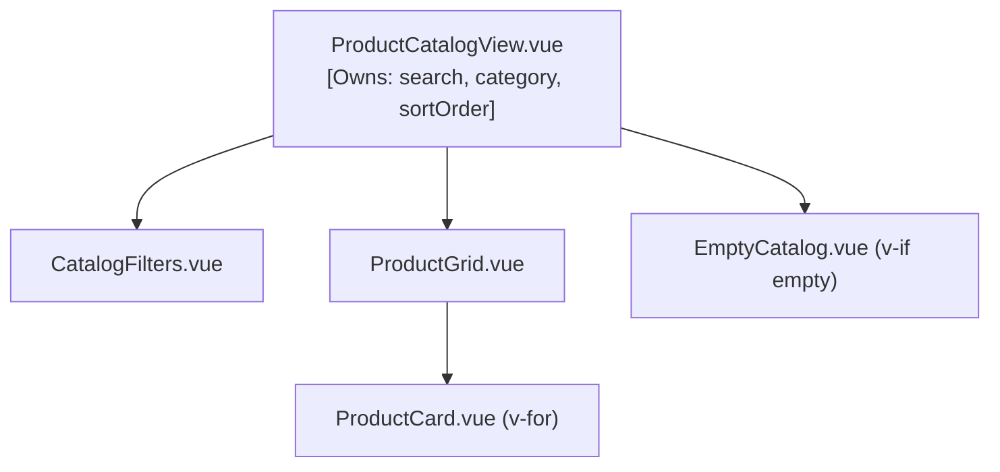
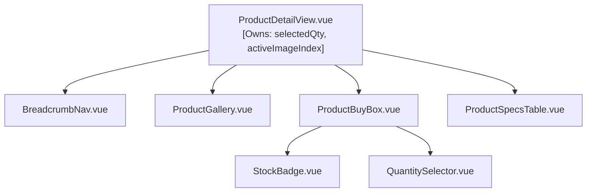
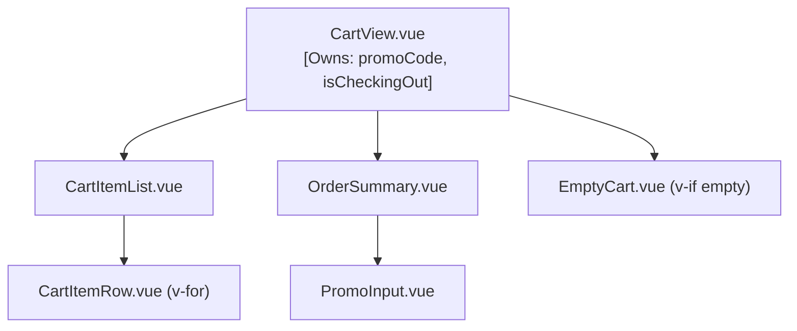
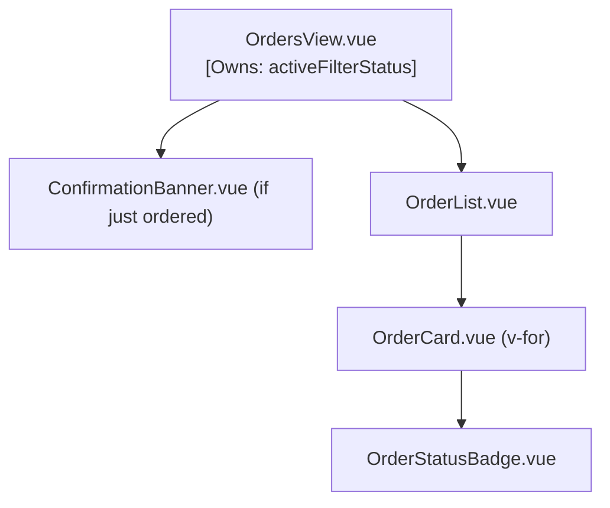

# Component Architecture & Component Tree: Campus Hub Shop

This document specifies the component hierarchy, props, events, and state ownership for each screen in the **Campus Hub Shop** application.

---

## 1. High-Level Architecture & Global State Ownership

### State Ownership Strategy
- **Products Catalog State (`products`)**: Owned by `App.vue` or loaded from `src/data/products.ts`. Serves as the single source of truth for all product data and inventory counts.
- **Cart State (`cartItems`)**: Owned at the application level (in `App.vue` or `useCartStore`), tracking array of `{ productId, quantity }`. Any component needing to add items emits an event up to the state owner.
- **Orders State (`orders`)**: Owned at the application level, initialized with past orders and appended when a checkout is completed.
- **Local Filter State (`search`, `category`, `sortOrder`)**: Owned locally by `ProductCatalogView.vue` because filtering only affects the immediate catalog presentation.

---

## 2. Screen 1: Product Catalog (`/products` or `/`)

### Component Tree (Mermaid)

### Components Specification

| Component | Props | Emits | State Owned |
| :--- | :--- | :--- | :--- |
| **`ProductCatalogView`** | `products: Product[]`, `cartCount: number` | `add-to-cart: (productId: number, quantity: number)` | `search: ref<string>`, `category: ref<Category \| 'all'>`, `sortOrder: ref<'price-asc' \| 'price-desc' \| 'popular'>`, `visibleProducts: computed<Product[]>` |
| **`CatalogFilters`** | `modelValueSearch: string`, `modelValueCategory: string`, `totalCount: number`, `visibleCount: number` | `update:modelValueSearch: (val: string)`, `update:modelValueCategory: (val: string)` | None (controlled inputs) |
| **`ProductGrid`** | `products: Product[]` | `add-to-cart: (productId: number, quantity: number)`, `select-product: (productId: number)` | None |
| **`ProductCard`** | `product: Product` | `add-to-cart: (productId: number)`, `view-details: (productId: number)` | Computed values: `isOutOfStock: computed<boolean>`, `isLowStock: computed<boolean>`, `formattedPrice: computed<string>` |
| **`EmptyCatalog`** | `searchQuery: string` | `reset-filters: ()` | None |

---

## 3. Screen 2: Product Detail (`/products/:id`)

### Component Tree (Mermaid)

### Components Specification

| Component | Props | Emits | State Owned |
| :--- | :--- | :--- | :--- |
| **`ProductDetailView`** | `product: Product` | `add-to-cart: (productId: number, quantity: number)` | `selectedQty: ref<number>`, `activeImageIndex: ref<number>` |
| **`ProductGallery`** | `images: string[]`, `title: string` | None | `activeIndex: ref<number>` |
| **`ProductBuyBox`** | `product: Product`, `quantity: number` | `update:quantity: (qty: number)`, `add-to-cart: (productId: number, quantity: number)` | None |
| **`StockBadge`** | `stock: number` | None | Computed: `badgeType: 'in-stock' \| 'low-stock' \| 'sold-out'`, `badgeText: string` |
| **`QuantitySelector`** | `modelValue: number`, `max: number`, `min?: number` | `update:modelValue: (qty: number)` | None (controlled component) |
| **`ProductSpecsTable`** | `specs: Record<string, string>` | None | None |

---

## 4. Screen 3: Cart & Checkout (`/cart`)

### Component Tree (Mermaid)

### Components Specification

| Component | Props | Emits | State Owned |
| :--- | :--- | :--- | :--- |
| **`CartView`** | `items: CartItemDetail[]` | `update-quantity: (productId: number, newQty: number)`, `remove-item: (productId: number)`, `clear-cart: ()`, `checkout: (orderData: CheckoutPayload)` | `promoCode: ref<string>`, `discountPercentage: ref<number>`, `subtotal: computed`, `total: computed` |
| **`CartItemList`** | `items: CartItemDetail[]` | `update-quantity: (productId: number, newQty: number)`, `remove-item: (productId: number)` | None |
| **`CartItemRow`** | `item: CartItemDetail` | `update-quantity: (newQty: number)`, `remove: ()` | Computed item total: `unitPrice * quantity` |
| **`OrderSummary`** | `subtotal: number`, `discount: number`, `tax: number`, `shipping: number`, `total: number` | `apply-promo: (code: string)`, `proceed-checkout: ()` | None |
| **`PromoInput`** | `activeDiscount: number` | `apply-promo: (code: string)` | `inputCode: ref<string>` |

---

## 5. Screen 4: Orders & Confirmation (`/orders`)

### Component Tree (Mermaid)

### Components Specification

| Component | Props | Emits | State Owned |
| :--- | :--- | :--- | :--- |
| **`OrdersView`** | `orders: Order[]` | None | `selectedOrderStatus: ref<string \| 'all'>` |
| **`ConfirmationBanner`**| `recentOrder: Order` | `dismiss: ()` | `visible: ref<boolean>` |
| **`OrderCard`** | `order: Order` | `reorder: (orderId: string)` | Computed: `itemCount: number`, `formattedDate: string` |
| **`OrderStatusBadge`** | `status: OrderStatus` | None | Computed: `statusClass: string`, `label: string` |

---

## 6. Unidirectional Data Flow ("Props Down, Events Up") Summary

1. **Props Down**:
   - `App.vue` passes `products` to `ProductCatalogView` and `ProductDetailView`.
   - `App.vue` passes `cartItems` and derived product details to `CartView`.
   - Parent components pass individual entity objects down into reusable leaf components (`ProductCard`, `CartItemRow`, `StockBadge`).

2. **Events Up**:
   - `ProductCard` emits `add-to-cart(id)`.
   - `ProductGrid` forwards `add-to-cart` to `ProductCatalogView`.
   - `ProductCatalogView` forwards `add-to-cart` to `App.vue` (or Pinia store).
   - `CartItemRow` emits `update-quantity(qty)` and `remove()` to `CartView`.
   - `CartView` emits updates to `App.vue`, ensuring state mutations occur only within the component that owns the data.
